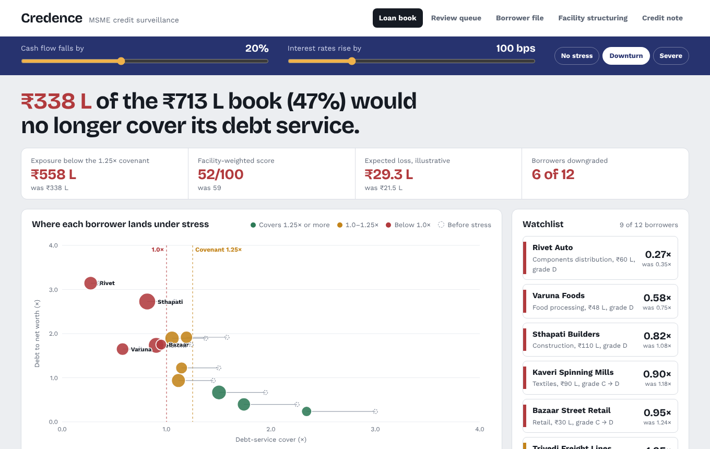
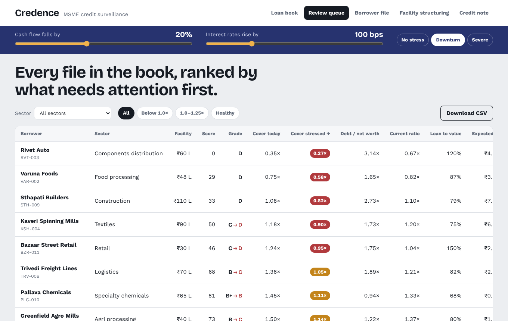

# Credence — MSME credit surveillance

**Live demo:** https://credence-fintech-analytics.vercel.app

**New to the subject?** Start with the [plain-English guide](https://credence-fintech-analytics.vercel.app/guide.html) ([source](guide.html)): live figures from the model, a tab-by-tab tour, an exploration checklist, a capability checklist, common questions and a glossary, written for readers with no finance background.

A credit-monitoring console for a fictional book of twelve Indian MSME borrowers. Two dials stress the whole book at once — a fall in cash flow and a rise in interest rates — and every view shows who stops covering their debt, how grades migrate, and what that does to expected loss.



## What it does

| View | What you get |
|---|---|
| **Loan book** | Headline exposure that would fall below 1.0× cover; exposure below the 1.25× covenant, facility-weighted score, illustrative expected loss and downgrade count, each compared with the unstressed book; a scatter of every borrower by stressed cover and leverage, with a line back to where it sat before stress; a ranked watchlist. |
| **Review queue** | Sortable, filterable table of all twelve files; sector concentration with the Herfindahl–Hirschman index and top-three share; a grade migration matrix; CSV export. |
| **Borrower file** | Editable financials and documents; the scorecard broken into its six components; ratios against monitoring thresholds; diligence items; base and stressed outcome. |
| **Facility structuring** | Term-loan amortisation, first-year cover including the new loan (today and under stress), loan-to-value, collateral cover after haircut and expected loss (PD × LGD × EAD). |
| **Credit note** | A review note generated from the live file and stress settings; downloadable. |



## Method

- **Scorecard (0–100)**: debt-service cover 25, current ratio 18, debt to net worth 16, revenue growth 14, interest cover 15, documentation 12. Thresholds are visible in the code and on screen.
- **Grades and PD**: score bands map to grades A–D, each with an illustrative 12-month PD used only for expected-loss arithmetic.
- **Stress**: cash available for debt service and EBIT fall by the chosen percentage; all existing debt reprices by the chosen basis points (a floating-rate assumption), raising interest and debt service.
- **Concentration**: `HHI = Σ (sector share × 100)²`.

The score is a transparent teaching indicator. It is not a probability-of-default model, a rating or a lending decision.

## Run it

```bash
python3 -m http.server 8080   # then open http://localhost:8080
npm test                      # Node 20+; no dependencies to install
```

Static site, no build step, no external requests (fonts are self-hosted).

## Project structure

```
index.html          markup for all five views
css/app.css         the whole visual system
src/engine.js       scorecard, stress, portfolio, migration, concentration, facility model; pure functions
src/app.js          UI wiring and rendering
src/charts.js       small dependency-free SVG chart kit
src/dom.js          formatting and routing helpers
tests/              node:test suite for the engine
fonts/              Bricolage Grotesque and Work Sans (SIL Open Font Licence)
```

## Tests

9 tests, including: every synthetic borrower passing validation and basic accounting sense (EBITDA ≥ EBIT, debt service ≥ interest); the original three cases keeping their published ratios and ordering; grades monotone in score; zero stress changing nothing and each shock moving cover by the expected formula; exposure buckets, expected loss and the migration matrix reconciling; concentration shares summing to one with HHI bounded; and the amortisation schedule repaying exactly the principal.

---

Independent case study by Nishant Khanke. Twelve fictional borrowers; no real lending data, bureau data or credit decisions.
